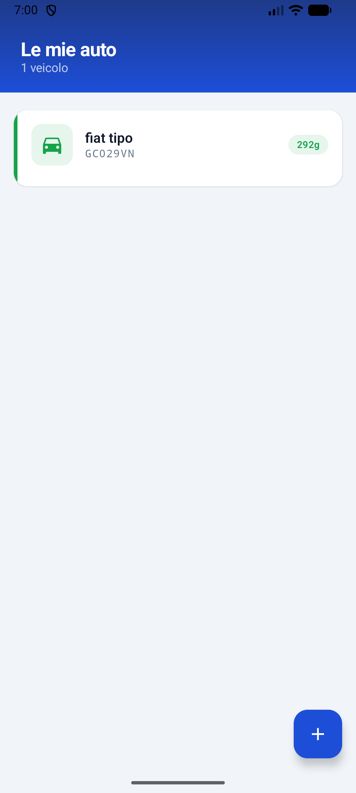
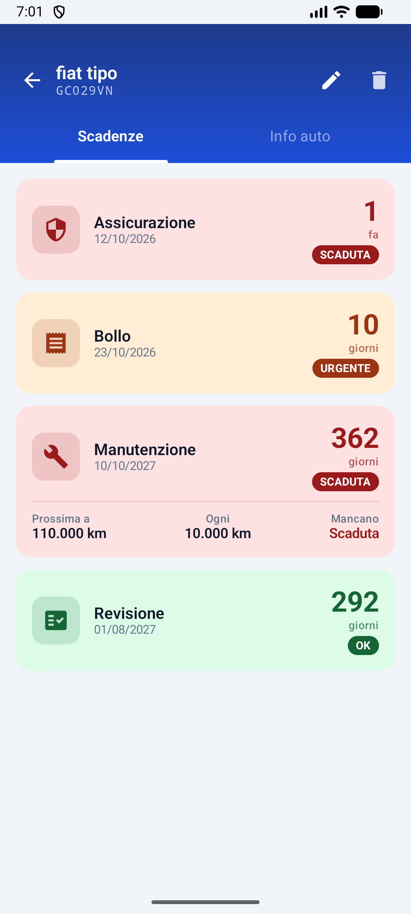
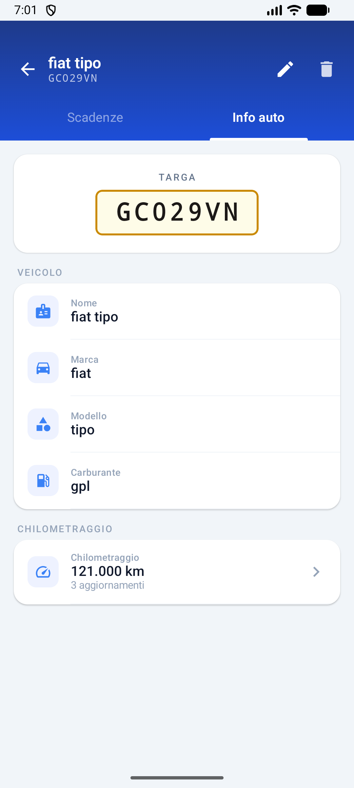
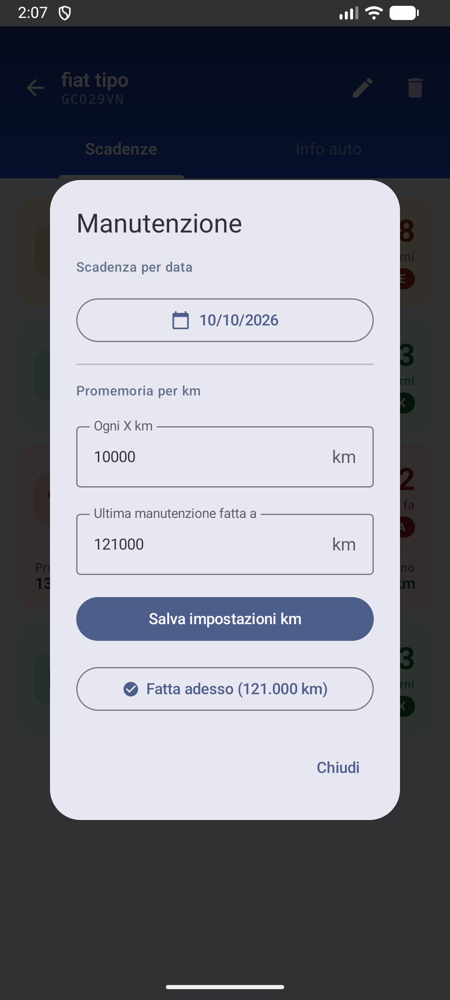

# 🚗 App Auto

Un'app Android per gestire i tuoi veicoli e non dimenticare mai una scadenza.  
Tieni traccia di assicurazione, bollo, revisione e manutenzione per ogni auto — con avvisi visivi basati sui giorni rimanenti o sui chilometri percorsi.

---

## Screenshot

<p align="center">
  
  
  
  
</p>

---

## Funzionalità

- **Gestione multi-veicolo** — aggiungi e gestisci più auto, ognuna con nome, marca, modello, carburante e targa
- **Scadenze** — assicurazione, bollo, revisione e manutenzione tutte in un posto
- **Avvisi a colori** — le card cambiano colore da verde → giallo → arancione → rosso man mano che la scadenza si avvicina, e diventano rosse quando è già scaduta
- **Promemoria manutenzione a km** — imposta un intervallo (es. ogni 10.000 km) e l'app calcola automaticamente quanti km mancano al prossimo tagliando
- **Storico chilometraggio** — registra le letture del contachilometri nel tempo e consulta lo storico completo
- **Rinnovo rapido** — pulsante "+1 anno" per rinnovare assicurazione, bollo e revisione in un tap

---

## Tecnologie

| Livello | Tecnologia |
|---|---|
| Linguaggio | **Kotlin** |
| UI | **Jetpack Compose** + Material 3 |
| Architettura | **MVVM** (ViewModel + StateFlow) |
| Database locale | **Room** |
| Task in background | **WorkManager** |
| Navigazione | **Navigation Compose** |
| Min SDK | Android 8.0 (API 26) |

---

## Build

Clona il repository e aprilo in Android Studio, oppure compila da riga di comando:

```bash
./gradlew assembleDebug
```

L'APK sarà disponibile in `app/build/outputs/apk/debug/app-debug.apk`.
